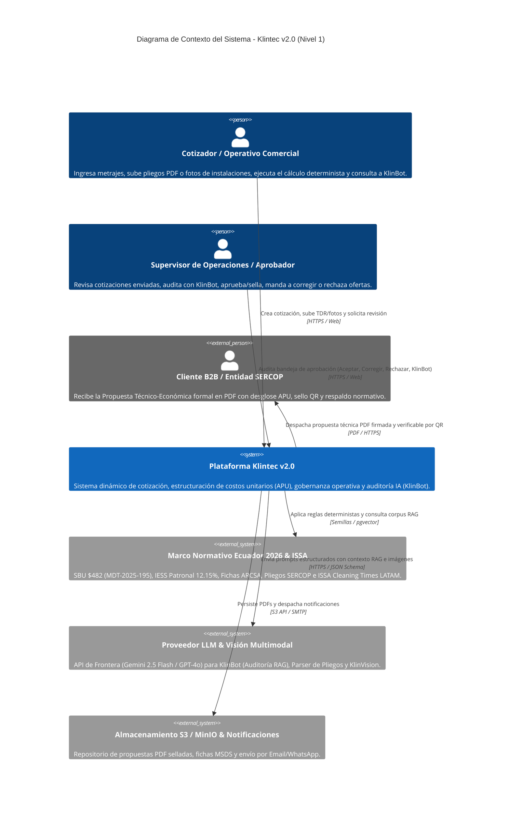
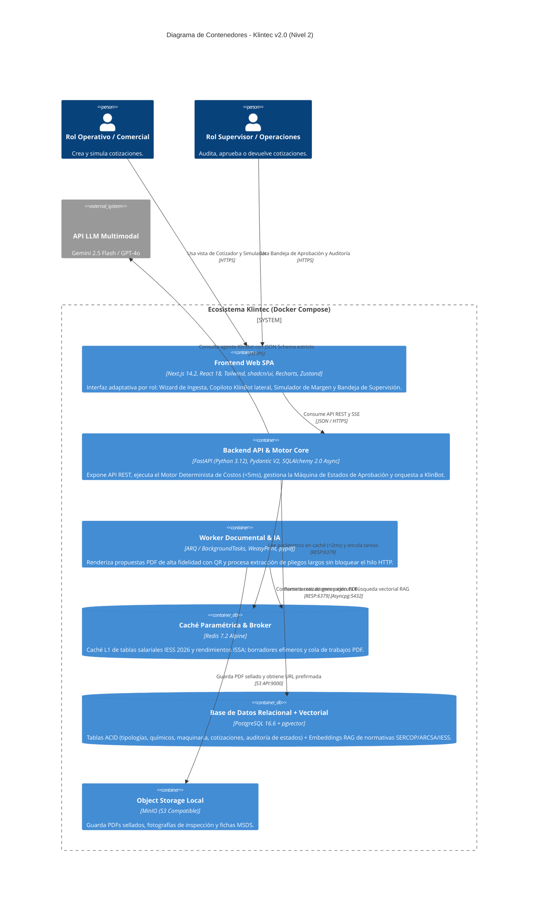
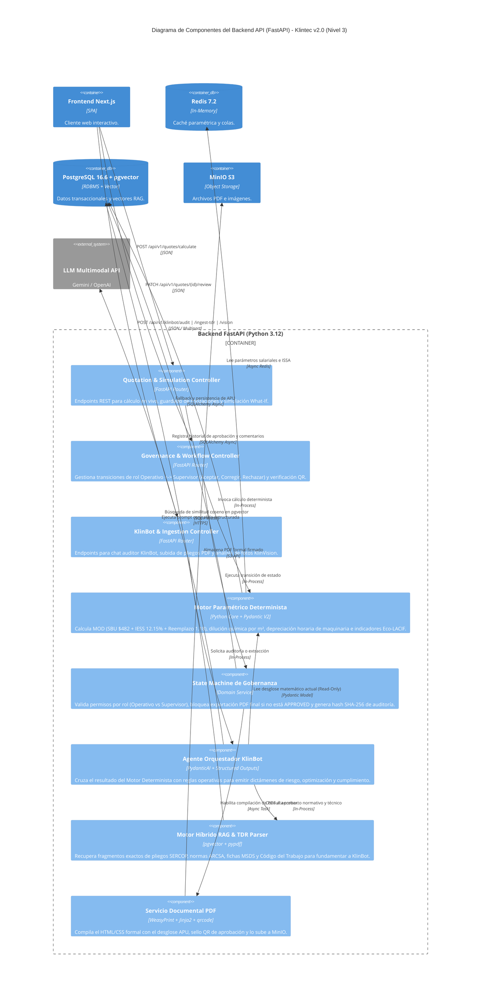

# ARQUITECTURA DE SOFTWARE: KLINTEC v2.0
**Sistema Dinámico de Cotización, Auditoría Operativa e Inteligencia de Costos Unitarios (APU) según Tipología de Infraestructura**  
**Reto Oficial:** Reto 2 – Sistema dinámico de cotización y estructuración de costos unitarios según tipología de infraestructura  
**Hackathon:** Expo Clean Ecuador 2026 | **Área Estratégica:** Gestión Inteligente de Procesos  

**Equipo y Roles Oficiales:**
- **Nick Valverde (`Nick09V`):** Product Owner, Estrategia Comercial B2B, Validación en Sitio & Pitch Lead
- **Bryan Salazar (`83espajuge-lgtm`):** Desarrollador Backend, Motor Paramétrico Determinista, Agente IA (KlinBot RAG/Vision) & Motor PDF
- **Alejandro Minda (`alejandro06020`):** Desarrollador Frontend UI/UX Principal (Wizard Operativo, Flujo de Roles y Simulador)
- **Roberth Jácome (`RoberthJacome`):** Desarrollador Fullstack de Integración, Visualización Analítica (Recharts) & Infraestructura/Deploy

---

## 1. Resumen Arquitectónico (Evolución a Klintec v2.0 Neuro-Simbólico)

La arquitectura de **Klintec v2.0** adopta un enfoque **Neuro-Simbólico y Determinista** diseñado para responder a cuatro requisitos críticos del sector de *Facility Management* y limpieza profesional en Ecuador (normativa 2026):

1. **Cero Alucinación Aritmética (Motor Determinista <50 ms):** Ningún cálculo financiero o laboral se delega a un modelo probabilístico (LLM). Todas las fórmulas de Mano de Obra Directa ($MOD$), Insumos Químicos y Dilución ($CIQ$), Depreciación Horaria de Maquinaria ($CMAQ$) y el **Piso Legal Inviolable (Candado Anti-Dumping FEDELIMP)** se ejecutan en Python puro validado con **Pydantic V2 (núcleo en Rust)** apoyado por caché en memoria **Redis L1 (<2 ms)**.
2. **Ingesta Multimodal e Inteligencia Operativa (KlinBot RAG + KlinVision + SERCOP Parser):** Un agente orquestador con salidas estructuradas (`Structured Outputs`) que:
   - Extrae metrajes, turnos y exigencias desde pliegos PDF/TDR del SERCOP (**KlinBot Document Parser**).
   - Identifica tipos de superficie, nivel de riesgo y sugiere insumos/maquinaria a partir de fotografías tomadas en sitio (**KlinVision**).
   - Audita la cotización calculada cruzándola contra una base vectorial **RAG en PostgreSQL (`pgvector`)** con normativa laboral ecuatoriana 2026 (Acuerdo MDT-2025-195 SBU $482, IESS 12,15%, Código del Trabajo), estándares sanitarios ARCSA y rendimientos **ISSA Cleaning Times (8th Edition Metric LATAM)**.
3. **Gobernanza Ligera Operativo–Supervisor (Approval Gate sin fricción de CRM):** Máquina de estados con cambio de rol instantáneo (*Role Switcher*) que conecta al **Cotizador / Operativo Comercial** con el **Supervisor de Operaciones / Aprobador** mediante 4 acciones de control (*Auditar con KlinBot*, *Aceptar y Sellar*, *Mandar a Corregir*, *Rechazar*).
4. **Trazabilidad y Propuesta Técnico-Económica Formal en PDF:** Generación de documentos multipágina con **WeasyPrint + Jinja2**, incluyendo desglose de Análisis de Precios Unitarios (APU), **Eco-Indicador de Dosificación Sostenible (LACIF)** y **Sello QR con hash criptográfico de verificación**.

---

## 2. Stack Tecnológico Optimizado (Versiones Estables / LTS)

| Capa / Componente | Tecnología Propuesta | Versión Estable / LTS | Justificación Técnica y Rol en el Sistema |
| :--- | :--- | :--- | :--- |
| **Frontend Framework** | **Next.js (App Router + TypeScript)** | **v14.2.x LTS** (React 18.3.1) | Estabilidad probada con librerías de gráficos y UI sin conflictos de hidratación; soporte híbrido SSR/CSR. |
| **UI & Sistema de Diseño** | **Tailwind CSS + shadcn/ui (Radix UI)** | **Tailwind v3.4.17** + **Radix v1.1** | Construcción ágil del Wizard de 4 pasos, Role Switcher, Sliders con candado legal, Modales de KlinBot y Badges de estado. |
| **Iconografía** | **Lucide React** | **v0.454+** | Iconografía técnica limpia para tipologías de infraestructura, bioseguridad, maquinaria y estados de auditoría. |
| **Visualización de Datos** | **Recharts** | **v2.12.7** | Renderizado fluido (<16 ms) de gráficos de composición de costos, Termómetro Competitivo SERCOP y comparativa *What-If*. |
| **Estado Cliente y Caché** | **Zustand + TanStack Query** | **Zustand v4.5.5** + **TanStack v5.59** | Zustand mantiene en memoria el estado del Wizard y simulador sin re-renders costosos; TanStack Query sincroniza API y estados de aprobación. |
| **Validación Frontend** | **React Hook Form + Zod** | **RHF v7.53** + **Zod v3.23.8** | Bloquea entradas inválidas (metrajes negativos, diluciones o porcentajes fuera de rango) antes de invocar al backend. |
| **Backend API & Runtime** | **FastAPI sobre Python** | **Python 3.12.7** + **FastAPI v0.115.x** | Ejecución asíncrona de alto rendimiento y documentación interactiva OpenAPI/Swagger autogenerada para evaluación técnica. |
| **Motor Determinista** | **Python Core + Pydantic V2** | **Pydantic v2.10.x (Rust Core)** | Validación estricta de matrices salariales, ecuaciones de costeo APU y esquemas JSON de salida de IA en microsegundos. |
| **Agente IA (KlinBot & Vision)** | **PydanticAI / Gemini SDK / OpenAI SDK** | **PydanticAI v0.0.14+** / **Gemini 2.5 Flash / GPT-4o** | Garantiza respuestas tipadas (`JSON Schema` estricto) para auditoría RAG de cotizaciones, parser de TDRs en PDF y análisis visual KlinVision. |
| **Base de Datos Relacional + RAG** | **PostgreSQL + `pgvector`** | **PostgreSQL 16.6** + **pgvector v0.7.4** | Unifica en un solo contenedor el motor relacional ACID (catálogos, cotizaciones, auditoría) y el motor vectorial RAG (normas IESS/ARCSA/SERCOP). |
| **ORM y Migraciones** | **SQLAlchemy Async + Alembic** | **SQLAlchemy v2.0.36** + **Alembic v1.14** | Consultas asíncronas no bloqueantes mediante `asyncpg` y modelos tipados modernos `Mapped[]`. |
| **Caché y Broker en Memoria** | **Redis Alpine** | **Redis v7.2.6 LTS / v7.4.1** | Caché L1 (<2 ms) para parámetros salariales IESS/SBU $482 y rendimientos ISSA, borradores efímeros y cola de trabajos PDF. |
| **Tareas Asíncronas** | **FastAPI `BackgroundTasks` / ARQ** | **ARQ v0.26.1** (sobre Redis) | Worker nativo `asyncio` ligero para compilación de PDFs y extracción documental sin bloquear el hilo HTTP. |
| **Motor Documental PDF** | **WeasyPrint + Jinja2 + qrcode** | **WeasyPrint v62.3/v63.0** + **Jinja2 v3.1.4** | Compila plantillas HTML5/CSS3 con diseño editorial corporativo, tablas APU y código QR verificable en PDFs listos para firma. |
| **Almacenamiento de Objetos** | **MinIO (S3 Compatible)** | **RELEASE.2024-10-13** | Almacena localmente en Docker los PDFs sellados, fotografías de inspección KlinVision y fichas técnicas MSDS con URLs prefirmadas. |
| **Contenedores y Despliegue** | **Docker & Docker Compose V2** | **Docker Engine v27.3** + **Compose v2.29** | Orquestación reproducible en local (offline-resilient en el Centro de Exposiciones Quito) con soporte de túnel Cloudflare/Vercel. |

---

## 3. Arquitectura Funcional en 4 Pilares

### Pilar 1: Entrada de Requerimientos Multimodal y Parametrización Guiada
1. **Formulario Wizard Estructurado (4 Tipologías Oficiales):**
   - **Hospitalaria / Crítica (Alto Riesgo):** Quirófanos, UCI, laboratorios. Desinfectantes de grado médico con registro ARCSA, EPP completo N95/Tyvek, microfibras codificadas (4 colores OMS) y rendimientos ISSA de 90–140 m²/h.
   - **Educativa (Medio-Alto Riesgo):** Escuelas, universidades, guarderías. Químicos biodegradables hipoalergénicos no tóxicos, alta frecuencia en baterías sanitarias y superficies de alto contacto.
   - **Corporativa y Comercial (Bajo-Medio Riesgo):** Edificios empresariales, bancos, centros comerciales y patios de comida. Uso intensivo de maquinaria (fregadoras automáticas, aspiradoras HEPA) con rendimientos de 300–600 m²/h.
   - **Industrial y Logística (Especializada):** Plantas de alimentos (inocuidad BPM/HACCP), bodegas de gran altura, remoción de grasas pesadas e hidrocarburos con hidrolavadoras industriales y trabajo en alturas.
2. **Ingesta Inteligente de Pliegos PDF/TDR (KlinBot Document Parser):** Extracción automática de entidad contratante, metrajes por área, turnos y exigencias técnicas desde pliegos del SERCOP en PDF.
3. **Asistente Visual de Levantamiento en Campo (KlinVision):** Análisis multimodal de fotografías de instalaciones para detectar tipo de superficie, nivel de desgaste/suciedad y recomendar el par óptimo de químico y maquinaria.

### Pilar 2: Motor Paramétrico Determinista (Core Matemático Auditable)
Ejecutado íntegramente en Python con validación Pydantic V2:

1. **Mano de Obra Directa Mensual ($MOD$):**
   $$\text{Horas Requeridas/Día} = \sum_{i=1}^{n} \left( \frac{\text{Área}_i \text{ (m}^2\text{)}}{\text{Rendimiento ISSA}_i \text{ (m}^2\text{/h)}} \times \text{Frecuencia Diaria}_i \right)$$
   $$\text{Operarios Base ($N_{op}$)} = \left\lceil \frac{\text{Horas Requeridas/Día}}{\text{Horas Efectivas por Turno (7,5 h)}} \right\rceil$$
   $$\text{Costo Mensual por Operario} = \left( \text{SBU}_{2026\text{ (\$482)}} + \text{Bonif. Especialidad} + \text{Recargo Nocturno}_{25\%} \right) + \text{IESS Patronal}_{12,15\%} + \text{Fondo Reserva}_{8,33\%} + \text{Décimo 3ro}_{8,33\%} + \text{Décimo 4to}_{\$40,17} + \text{Vacaciones}_{4,17\%}$$
   $$MOD_{\text{Total}} = N_{op} \times \text{Costo Mensual por Operario} \times \text{Factor de Reemplazo/Ausentismo } (1,18)$$

2. **Insumos Químicos, Dilución y Bioseguridad ($CIQ$):**
   $$\text{Litros Solución Lista} = \frac{\text{Área}_i \times \text{Frecuencia Mensual}}{\text{Rendimiento Superficie (m}^2\text{/L solución)}}$$
   $$\text{Litros Concentrado Puro} = \text{Litros Solución Lista} \times \left( \frac{1}{1 + \text{Factor Dilución } D} \right) \times (1 + \text{Merma}_{3\%})$$
   $$CIQ_{\text{Total}} = \sum (\text{Litros Concentrado Puro} \times \text{Costo Unitario Litro}) + \text{Costo Consumibles/Microfibras} + \text{Kits EPP}$$

3. **Depreciación Horaria de Maquinaria y Equipos ($CMAQ$):**
   $$\text{Costo Horario Equipo}_k = \frac{\text{Valor Adquisición}_k - \text{Valor Residual}_k}{\text{Vida Útil en Horas}_k} + \text{Mantenimiento Preventivo/Hora}_k + \text{Consumibles Desgaste (Pads/Cepillos)}_k$$
   $$CMAQ_{\text{Total}} = \sum_{k} \left( \text{Costo Horario Equipo}_k \times \text{Horas de Uso Mensual}_k \right)$$

4. **Estructuración del Precio Final y Piso Legal Inviolable (Candado FEDELIMP):**
   $$\text{Costo Operativo Directo (Piso Inviolable)} = MOD_{\text{Total}} + CIQ_{\text{Total}} + CMAQ_{\text{Total}}$$
   $$\text{Subtotal Oferta} = \text{Costo Operativo Directo} \times \left( 1 + \% \text{Gastos Administrativos} + \% \text{Imprevistos Riesgo} + \% \text{Margen Neto} \right)$$

### Pilar 3: Máquina de Estados de Gobernanza Ligera (2 Roles) y Agente KlinBot
- **Rol 1 – Cotizador / Operativo Comercial:** Configura la cotización, ejecuta la pre-auditoría preventiva con **KlinBot** y envía la oferta a supervisión (`DRAFT` $\rightarrow$ `IN_REVIEW`). Mientras no esté aprobada, cualquier vista previa lleva marca de agua `"BORRADOR NO VÁLIDO"`.
- **Rol 2 – Supervisor de Operaciones / Aprobador:** Accede a la bandeja ejecutiva y ejecuta una de las **4 acciones de gobernanza**:
  1. **Auditar con KlinBot (`AI_AUDIT`):** Dictamen técnico-legal con citas RAG (IESS, ARCSA, SERCOP) y sugerencias de optimización de turnos/maquinaria.
  2. **Aceptar y Sellar (`APPROVED`):** Genera hash criptográfico `SHA-256`, activa el código QR verificable y desbloquea la descarga/despacho del PDF formal.
  3. **Mandar a Corregir (`CHANGES_REQUESTED`):** Devuelve la cotización al operativo con observaciones ancladas al rubro.
  4. **Rechazar (`REJECTED`):** Bloquea ofertas con riesgo operativo o incumplimiento de políticas.

### Pilar 4: Dashboards Interactivos, Simulador "What-If", Eco-Indicador y Motor PDF
- **Matriz Analítica de Precios Unitarios (APU):** Tabla filtrable por Nómina, Químicos, Maquinaria y EPP con respaldo normativo.
- **Simulador de Sensibilidad Comercial ("What-If"):**
  - *Candado de Piso Legal FEDELIMP:* Bloquea cualquier intento de cotizar bajo el Costo Operativo Directo + Cargas Legales IESS 2026.
  - *Termómetro Competitivo Sectorial:* Compara el costo/m² contra históricos referenciales del SERCOP en Pichincha.
  - *Simulador de Descuento en Vivo (`-3%` / `-5%`):* Calcula el impacto exacto en la utilidad neta en dólares manteniendo 100% intocable la nómina de los operarios.
- **Eco-Indicador de Dosificación Sostenible (Huella Hídrica y Química LACIF):** Cuantifica el ahorro mensual en litros de agua y envases plásticos de galón logrado por la dilución paramétrica exacta frente al método empírico tradicional.

---

## 4. Modelo C4 Completo en 3 Niveles

### Nivel 1: Diagrama de Contexto del Sistema (C4 System Context)



### Nivel 2: Diagrama de Contenedores (C4 Container Diagram)



### Nivel 3: Diagrama de Componentes del Backend & Motor Inteligente (C4 Component Diagram)



---

## 5. Detalle del Uso de Redis en Klintec v2.0

Redis garantiza respuesta en tiempo real (<50 ms end-to-end) durante el ajuste del slider de sensibilidad y la demostración en vivo:

1. **Caché de Parámetros Maestros L1 (`<2 ms`):**
   - `param:labor:ecuador:2026` $\rightarrow$ JSON serializado con SBU ($482,00), aporte patronal IESS (12,15%), fondo de reserva (8,33%), décimos, vacaciones (4,17%), recargo nocturno (25%) y factor de reemplazo (1,18).
   - `param:typologies:catalog` $\rightarrow$ Tasas de producción horaria ISSA Cleaning Times (m²/h), kits EPP y exigencias por cada una de las 4 tipologías.
   - `param:chemicals:yields` y `param:machinery:depreciation` $\rightarrow$ Matrices de dilución, merma (3%) y costo horario de equipos.
2. **Cola Ligera de Tareas Documentales (`ARQ / BackgroundTasks`):**
   - Gestiona los trabajos asíncronos de renderizado PDF con WeasyPrint y almacenamiento en MinIO (`task:pdf:{quote_id}`).
3. **Borradores Efímeros de Simulación (`Scratchpad`):**
   - Almacena simulaciones temporales (`quote:draft:{session_id}`) con TTL de 2 horas mientras el operativo mueve el slider *What-If*.

---

## 6. Modelo de Datos Relacional + Vectorial (`PostgreSQL 16.6 + pgvector`)

1. **`typologies` (4 Tipologías Oficiales de Infraestructura):**
   - `id`, `code` (`HOSPITAL_CRITICAL`, `EDUCATIONAL`, `CORPORATE_COMMERCIAL`, `INDUSTRIAL_LOGISTICS`), `name`, `risk_level`, `issa_base_yield_sqm_h`, `benchmark_sercop_usd_sqm`, `required_epp_json`.
2. **`surfaces` (Catálogo de Superficies y Rendimientos ISSA):**
   - `id`, `typology_id`, `name` (Vinilo hospitalario conductivo, Quirófano/UCI, Porcelanato alto tráfico, Baterías sanitarias, Piso industrial epóxico, Vidrios en altura), `issa_yield_sqm_per_hour`, `solution_coverage_sqm_per_liter`, `difficulty_factor`.
3. **`chemicals` (Insumos Químicos y Bioseguridad ARCSA):**
   - `id`, `name` (ej. Amonio Cuaternario 5.ª Gen, Desengrasante Alcalino Industrial, Peróxido de Hidrógeno Acelerado, Detergente Biodegradable Hipoalergénico), `dilution_factor` ($D$, ej. `64` para 1:64), `waste_pct` (3%), `price_per_liter_usd`, `arcsa_registration`, `msds_url`, `eco_water_saving_pct`.
4. **`machinery` (Maquinaria y Equipos):**
   - `id`, `name` (Fregadora Hombre a Bordo, Fregadora Compacta HEPA, Nebulizador ULV, Abrillantadora Alta Revolución, Hidrolavadora Industrial, Aspiradora HEPA), `acquisition_cost_usd`, `residual_value_usd`, `lifespan_hours`, `maintenance_hourly_usd`, `consumables_hourly_usd`.
5. **`labor_parameters` (Parámetros Legales Ecuador 2026):**
   - `id`, `year` (`2026`), `sbu_usd` (`482.00`), `iess_patronal_pct` (`0.1215`), `reserve_fund_pct` (`0.0833`), `thirteenth_pct` (`0.0833`), `fourteenth_monthly_usd` (`40.17`), `vacation_pct` (`0.0417`), `night_surcharge_pct` (`0.25`), `effective_shift_hours` (`7.5`), `replacement_factor` (`1.18`), `legal_reference` (`Acuerdo Ministerial MDT-2025-195`).
6. **`quotations` (Cotizaciones y Estado de Gobernanza):**
   - `id` (UUID), `code` (`KLT-2026-XXXX`), `client_name`, `typology_id`, `total_sqm`, `mod_total_usd`, `ciq_total_usd`, `cmaq_total_usd`, `direct_operating_cost_usd` (*Piso Legal Inviolable*), `admin_pct`, `risk_pct`, `margin_pct`, `final_monthly_price_usd`, `cost_per_sqm_usd`, `status` (`DRAFT`, `IN_REVIEW`, `APPROVED`, `CHANGES_REQUESTED`, `REJECTED`), `approval_hash`, `supervisor_notes`, `klinbot_audit_json`, `eco_metrics_json`, `pdf_url`, `created_at`, `approved_at`.
7. **`quotation_items` (Líneas de Desglose APU por Área/Turno):**
   - `id`, `quotation_id`, `surface_id`, `area_sqm`, `daily_frequency`, `shift_type` (`DIURNO`, `NOCTURNO`, `24_7`), `specialty_bonus_usd`, `required_hours_day`, `assigned_operators`, `chemical_id`, `machinery_id`, `machinery_hours_month`, `subtotal_mod_usd`, `subtotal_ciq_usd`, `subtotal_cmaq_usd`.
8. **`quotation_audit_logs` (Trazabilidad Operativo $\leftrightarrow$ Supervisor):**
   - `id`, `quotation_id`, `actor_role` (`OPERATIVO`, `SUPERVISOR`, `KLINBOT`), `action` (`CREATE`, `SUBMIT_REVIEW`, `AI_AUDIT`, `APPROVE`, `REQUEST_CHANGES`, `REJECT`), `previous_status`, `new_status`, `comment`, `created_at`.
9. **`normative_chunks` (Corpus Vectorial RAG con `pgvector`):**
   - `id`, `source_type` (`IESS_MDT_2026`, `ARCSA_BIOSECURITY`, `SERCOP_TDR`, `ISSA_LATAM`, `MSDS`), `title`, `article_ref`, `content`, `embedding` (`vector(768)` / `vector(1536)`).

---

## 7. Flujos de Trabajo Críticos (End-to-End)

### Flujo 1: Ingesta Multimodal (Wizard / SERCOP PDF / KlinVision) + Cálculo Determinista (<50 ms)
```text
[Operativo Comercial (Next.js)]
    │  1a. Ingresa áreas/turnos en Wizard O sube Pliego PDF / Foto KlinVision
    ▼
[FastAPI: /api/v1/klinbot/ingest-tdr | /vision] (Opcional)
    │  Extrae JSON estructurado (superficie, m², riesgo, insumos sugeridos)
    ▼
[FastAPI: POST /api/v1/quotes/calculate]
    │  2. Lee parámetros SBU $482, IESS 12.15% e ISSA desde Redis (<2 ms)
    │  3. Ejecuta Motor Determinista (MOD + CIQ + CMAQ + Piso Inviolable + Eco-LACIF)
    ▼
[Frontend Next.js (Zustand + Recharts)]
    └──► Renderiza Matriz APU, Dona de Costos, Termómetro SERCOP y Simulador What-If
```

### Flujo 2: Gobernanza Operativo $\leftrightarrow$ Supervisor, Auditoría KlinBot RAG y Sello PDF con QR
```text
[Operativo Comercial] ──(1. Envía a Revisión: IN_REVIEW)──► [Bandeja del Supervisor]
                                                                    │
        ┌───────────────────────────────────────────────────────────┤
        ▼ (Acción 1: Auditar con KlinBot)                           ▼ (Acción 2: Aceptar y Sellar)
[KlinBot Service + pgvector RAG]                         [State Machine: Estado -> APPROVED]
  - Cruza JSON del APU con normas IESS/ARCSA               - Genera Hash SHA-256 + URL Verificación QR
  - Emite alertas de riesgo y optimización                 - Compila PDF con WeasyPrint + Sube a MinIO
                                                           - Desbloquea descarga formal y escaneo QR
```

---

## 8. Estrategia de Despliegue Reproducible (`docker-compose.yml`)

Diseñada para operar con latencia cero en el Centro de Exposiciones Quito (modo local resiliente + túnel público para escaneo de QR del jurado):

- **`klintec-db` (`pgvector/pgvector:pg16`):** PostgreSQL 16.6 con extensión `vector` habilitada y ejecución automática de `seed.py` (SBU $482, 4 tipologías, 12 químicos ARCSA, 8 maquinarias, 4 casos semilla reales incluyendo *Hospital Metropolitano de Quito 4.850 m²* y corpus normativo RAG).
- **`klintec-redis` (`redis:7.2-alpine`):** Caché paramétrica en memoria y broker de tareas documentales.
- **`klintec-minio` (`minio/minio`):** Object Storage S3 local con bucket `klintec-proposals` preconfigurado.
- **`klintec-backend` (`python:3.12-slim`):** API FastAPI + Motor Determinista + Agente KlinBot + WeasyPrint.
- **`klintec-frontend` (`node:20-alpine`):** Aplicación web Next.js 14.2 con Role Switcher en vivo, Wizard, Simulador What-If y Visor PDF.
