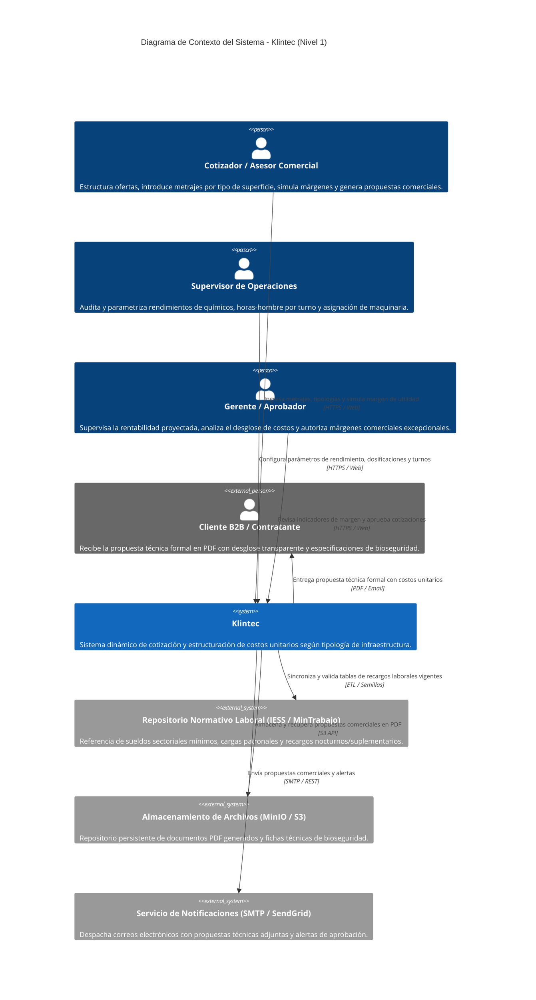
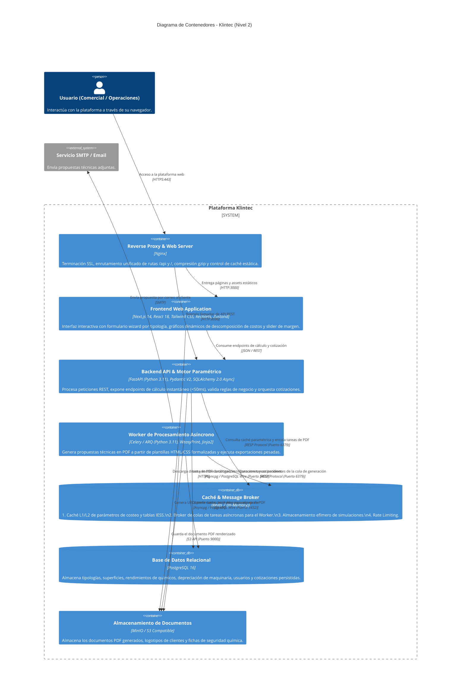

# ARQUITECTURA DE SOFTWARE: KLINTEC
**Reto 2:** Sistema dinámico de cotización y estructuración de costos unitarios según tipología de infraestructura  
**Hackathon:** Expo Clean Ecuador 2026 | **Área:** Gestión Inteligente de Procesos  
**Product Owner:** Nick Valverde  

---

## 1. Stack Tecnológico Requerido

El stack tecnológico de Klintec ha sido seleccionado para cumplir con tres requisitos indispensables del reto: **simulación de costos en tiempo real (<50 ms)**, **precisión paramétrica en normativa laboral y operativa ecuatoriana**, y **generación asíncrona de propuestas comerciales en PDF formal**.

| Capa / Componente | Tecnología | Justificación y Rol en el Sistema |
| :--- | :--- | :--- |
| **Frontend Web** | **Next.js 14+ (React 18/19, TypeScript, App Router)** | Framework moderno para construir una SPA reactiva con Server-Side Rendering (SSR) cuando se requiere SEO/catálogo y Client Components para interactividad fluida en el cotizador. |
| **Diseño y UI** | **Tailwind CSS + Shadcn UI (Radix Primitives)** | Acelera el desarrollo del prototipo con componentes accesibles, consistentes y de nivel comercial (modales, sliders de margen, tabs por tipología, tablas interactivas). |
| **Iconografía** | **Lucide React** | Conjunto de iconos limpio, coherente y liviano para infraestructura, maquinaria y bioseguridad. |
| **Visualización de Datos** | **Recharts** | Renderizado de gráficos interactivos (dona, barras apiladas) para visualizar en tiempo real la descomposición del costo: Mano de Obra (60-70%) vs. Químicos vs. Maquinaria vs. Margen. |
| **Estado y Conectividad** | **Zustand + TanStack Query (React Query)** | Zustand para el estado global del formulario multicapa de cotización en memoria cliente; TanStack Query para caché y sincronización eficiente de datos con la API. |
| **Validaciones Frontend** | **Zod + React Hook Form** | Validación estricta en tiempo de ejecución de metrajes, turnos, frecuencias y porcentajes antes de enviar la carga al backend. |
| **Backend API** | **FastAPI (Python 3.11+)** | Framework web asíncrono de alto rendimiento. Ofrece tipado estricto con Pydantic V2, generación automática de documentación interactiva (OpenAPI/Swagger) y velocidad óptima para cálculos matemáticos. |
| **Motor Paramétrico** | **Python Core + Pydantic V2** | Lógica de negocio pura para el cálculo de costos unitarios: matrices de rendimiento por m², cargas sociales de Ecuador (IESS 12.15%, décimos, fondos de reserva, factor de reemplazo), dilución de químicos y amortización horaria de equipos. |
| **ORM y Migraciones** | **SQLAlchemy 2.0 (Async) + Alembic** | Mapeo objeto-relacional asíncrono para PostgreSQL, facilitando consultas de alta velocidad y control de versiones del esquema de base de datos. |
| **Caché y Broker en Memoria** | **Redis 7+** | **Caché paramétrica L1/L2:** almacena en memoria tablas de salarios IESS, rendimientos químicos y tipologías.<br>**Message Broker:** gestiona la cola de tareas asíncronas para generación de PDFs y exportaciones.<br>**Simulaciones efímeras:** guarda estados de borradores de cotización en memoria sin saturar la base relacional.<br>**Rate Limiting:** control de peticiones para evitar abusos en generación de documentos. |
| **Worker de Tareas** | **Celery / ARQ (Python)** | Procesamiento en segundo plano desacoplado del ciclo de vida HTTP. Procesa la compilación de documentos PDF pesados sin bloquear la experiencia del usuario. |
| **Motor de Documentos** | **WeasyPrint + Jinja2 Templates** | Motor de renderizado HTML/CSS hacia PDF de alta fidelidad tipográfica (CSS Paged Media, encabezados formales, numeración de páginas, membretes y tablas de cotización desglosadas). |
| **Base de Datos Relacional** | **PostgreSQL 16** | Motor relacional robusto con soporte ACID y tipos JSONB para almacenar parámetros dinámicos de cotización, catálogo de insumos, tablas salariales y auditoría histórica. |
| **Almacenamiento de Objetos** | **MinIO (Local/Demo) / AWS S3 (Producción)** | Almacenamiento desacoplado para propuestas comerciales generadas en PDF, fichas técnicas de químicos (MSDS) y anexos del servicio. |
| **Proxy Inverso y Web Server** | **Nginx** | Reverse Proxy para terminación SSL, enrutamiento unificado de frontend y backend, balanceo y compresión estática. |
| **Contenedores y Orquestación** | **Docker & Docker Compose** | Entorno 100% reproducible multicontenedor que permite levantar todo el stack en local en un solo comando durante la evaluación del Hackathon. |

---

## 2. Modelo C4 - Nivel 1: Diagrama de Contexto del Sistema (System Context)

El diagrama de contexto ilustra los usuarios principales de Klintec y sus interacciones con los sistemas satélites y normativos del sector de limpieza y facility management en Ecuador.



### Descripción de Actores y Entidades Externas

1. **Cotizador / Asesor Comercial:** Usuario comercial que necesita responder licitaciones o requerimientos de clientes en minutos, ajustando parámetros y simulando el margen de ganancia sin comprometer la viabilidad financiera.
2. **Supervisor de Operaciones:** Garante técnico de la empresa. Asegura que los estándares de bioseguridad (hospitales vs. oficinas) y los consumos reales de químicos y horas-hombre se respeten en el algoritmo.
3. **Gerente / Aprobador:** Visualiza el tablero gerencial para validar que ninguna propuesta se venda bajo el punto de equilibrio operativo.
4. **Cliente B2B:** Entidad corporativa, comercial o de salud que recibe una cotización transparente, profesional y técnicamente justificada.
5. **Sistemas Externos:**
   - **Repositorio Normativo Laboral:** Provee las fórmulas fijas de recargos del IESS (12.15%), décimo tercer y décimo cuarto sueldo, fondos de reserva y factor de sustitución de personal.
   - **MinIO / S3:** Garantiza durabilidad y acceso inmediato a los PDFs firmables generados.
   - **Servicio de Notificaciones:** Canal de distribución directo al cliente final.

---

## 3. Modelo C4 - Nivel 2: Diagrama de Contenedores (Container Diagram)

El diagrama de contenedores detalla los límites de ejecución, tecnologías, almacenamiento y mecanismos de comunicación interna de la plataforma Klintec, resaltando el rol protagónico de **Redis** para desacoplar el procesamiento pesado y garantizar latencia ultra baja.



---

## 4. Detalle y Ampliación del Uso de Redis en Klintec

Redis es una pieza central en la arquitectura de Klintec para asegurar que la aplicación responda de forma instantánea en escenarios comerciales de alta concurrencia y durante la demostración en vivo del Hackathon:

### A. Caché de Parámetros Maestros (Sub-millisecond Latency)
- **Problema:** En cada movimiento del slider o ajuste de metraje, el motor de costeo evalúa tablas salariales del sector de limpieza (SBU Ecuador, aportes patronales IESS 12.15%, decimotercero, decimocuarto, fondos de reserva, factor de reemplazo 1.15 a 1.25) y rendimientos de químicos (dilución por litro/m² según superficie).
- **Solución con Redis:**
  - `KEY: param:labor:ecuador:2026` -> Almacena en JSON serializado los factores y sueldos mínimos sectoriales.
  - `KEY: param:chemical:yields:{typology_id}` -> Almacena la matriz de consumo de químicos por m² y superficie.
  - El backend FastAPI consulta primero Redis (`GET`). Solo si hay un *cache-miss* va a PostgreSQL y repuebla la clave con TTL configurable (e.g., 24 horas). Esto reduce la latencia de cálculo a **<5 ms**.

### B. Broker de Mensajería para Generación Asíncrona de PDF
- **Problema:** La generación de un documento PDF formal con WeasyPrint (renderizado de estilos CSS de imprenta, gráficos vectoriales y páginas múltiples) toma entre 1.5 y 3 segundos. Ejecutarlo síncronamente en el hilo HTTP degradaría la experiencia y bloquearía el servidor.
- **Solución con Redis:**
  - El usuario hace clic en *"Generar Propuesta Técnica en PDF"*.
  - FastAPI valida la cotización y publica un mensaje en la cola Redis: `tasks:pdf_generation`.
  - FastAPI responde de inmediato al frontend con un `task_id` y estado `PENDING`.
  - El **Worker (Celery/ARQ)** toma la tarea de Redis, compila el PDF con WeasyPrint, lo sube a MinIO/S3 y actualiza el estado en Redis: `KEY: task:status:{task_id}` a `COMPLETED` con la URL de descarga.

### C. Almacenamiento Efímero de Simulaciones (Scratchpad de Cotizaciones)
- Los cotizadores prueban múltiples escenarios cambiando tipologías, turnos y márgenes sin necesidad de guardarlos permanentemente en PostgreSQL.
- Se almacenan borradores temporales en Redis con TTL de 2 horas (`KEY: quote:draft:{session_uuid}`), evitando escrituras y fragmentación innecesaria en la base de datos relacional.

### D. Rate Limiting y Control de Concurrencia
- Protege los endpoints costosos de exportación de documentos mediante algoritmos de *Token Bucket* en Redis, evitando ataques de denegación de servicio o saturación de workers en demostraciones concurrentes.

---

## 5. Modelo de Datos y Entidades Principales (PostgreSQL)

El esquema relacional en PostgreSQL 16 estructura los costos unitarios en tablas normalizadas:

1. **`typologies` (Tipologías de Infraestructura):**
   - `id`, `name` (Corporativo, Comercial, Crítico/Hospitalario), `risk_level`, `standard_turnaround_hours`.
2. **`surfaces` (Tipos de Superficie):**
   - `id`, `name` (Pisos duros, Alfombras, Vidrios internos/alturas, Baterías sanitarias), `difficulty_factor`.
3. **`chemicals` (Insumos y Productos Químicos):**
   - `id`, `name`, `dilution_ratio` (ej. 1:50), `yield_sqm_per_liter`, `unit_cost_usd`, `biosecurity_standard`.
4. **`machinery` (Equipamiento y Maquinaria):**
   - `id`, `name` (Abrillantadora, Hidrolavadora, Aspiradora industrial), `purchase_cost_usd`, `lifespan_hours`, `maintenance_cost_hourly`.
5. **`labor_parameters` (Normativa Laboral Ecuador):**
   - `id`, `year`, `base_salary_sbu`, `iess_contribution_pct` (12.15%), `thirteenth_salary`, `fourteenth_salary`, `reserve_funds_pct`, `replacement_factor`.
6. **`quotations` (Cotizaciones):**
   - `id`, `client_name`, `typology_id`, `total_sqm`, `operating_cost_usd`, `margin_pct`, `total_price_usd`, `status` (DRAFT, APPROVED, SENT), `created_at`.
7. **`quotation_items` (Desglose por Superficie y Turno):**
   - `id`, `quotation_id`, `surface_id`, `area_sqm`, `shift_type` (Diurno, Nocturno), `assigned_personnel`, `direct_cost_labor`, `direct_cost_chemicals`, `direct_cost_machinery`.

---

## 6. Flujos de Trabajo Críticos

### Flujo 1: Simulación Dinámica de Costos (Tiempo Real)
```text
[Frontend Next.js] 
    │  1. Evento de cambio en Metraje / Superficie / Turno
    ▼
[Backend FastAPI]
    │  2. Consulta parámetros en Redis (Tablas IESS, rendimientos químicos)
    ▼
[Redis Cache] ──(Datos en <2ms)──► [Motor Paramétrico FastAPI]
    │  3. Calcula Horas-Hombre + Insumos + Maquinaria + Margen
    ▼
[Frontend Next.js] ──(Renderiza Donut Chart en Recharts en <50ms)
```

### Flujo 2: Generación y Descarga de Propuesta en PDF
```text
[Frontend Next.js] ──(POST /api/v1/quotes/{id}/generate-pdf)──► [FastAPI]
                                                                     │ Encola tarea
                                                                     ▼
                                                              [Redis Task Queue]
                                                                     │ Consume tarea
                                                                     ▼
                                                              [Celery/ARQ Worker]
                                                                     │ 1. Renderiza con WeasyPrint
                                                                     │ 2. Sube a MinIO / S3
                                                                     ▼
                                                              [MinIO / S3 Storage]
                                                                     │ Notifica finalización
                                                                     ▼
[Frontend Next.js] ◄──(Descarga PDF con URL prefirmada)──────────────┘
```

---

## 7. Estrategia de Despliegue para el Hackathon (Docker Compose)

Para asegurar reproducibilidad absoluta en el entorno de evaluación del pabellón del Centro de Exposiciones Quito (sin depender de conectividad a internet externa inestable), todos los contenedores se integran mediante `docker-compose.yml`:

- **Servicio `klintec-db`:** PostgreSQL 16 con volumen persistente y script de semillas automáticas (datos precargados de rendimientos y salarios IESS 2026).
- **Servicio `klintec-cache`:** Redis 7 Alpine configurado con persistencia RDB periódica.
- **Servicio `klintec-storage`:** MinIO con bucket inicial `proposals` preconfigurado.
- **Servicio `klintec-backend`:** FastAPI con Uvicorn multi-worker conectado a Redis y PostgreSQL.
- **Servicio `klintec-worker`:** Worker Celery ejecutando WeasyPrint.
- **Servicio `klintec-frontend`:** Next.js optimizado con build standalone en Node.js 20.
- **Servicio `klintec-gateway`:** Nginx unificando el puerto `80/443` para acceso directo en la red local del hackathon.
