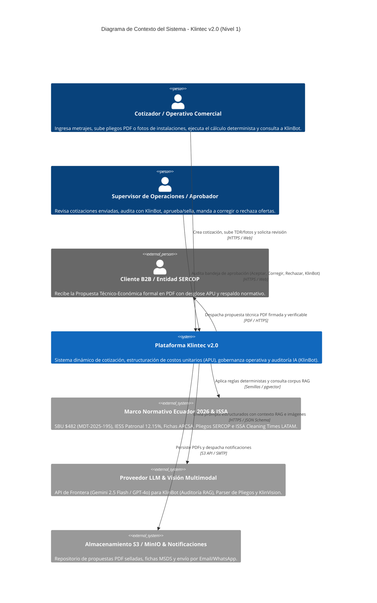
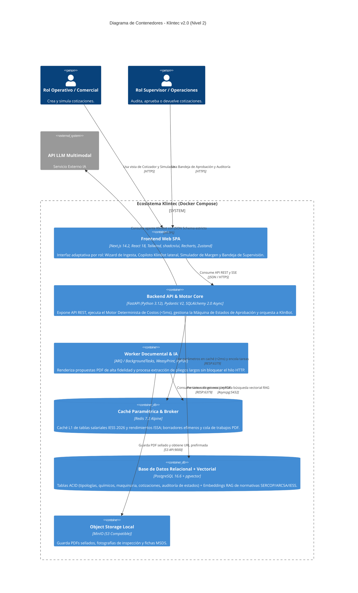
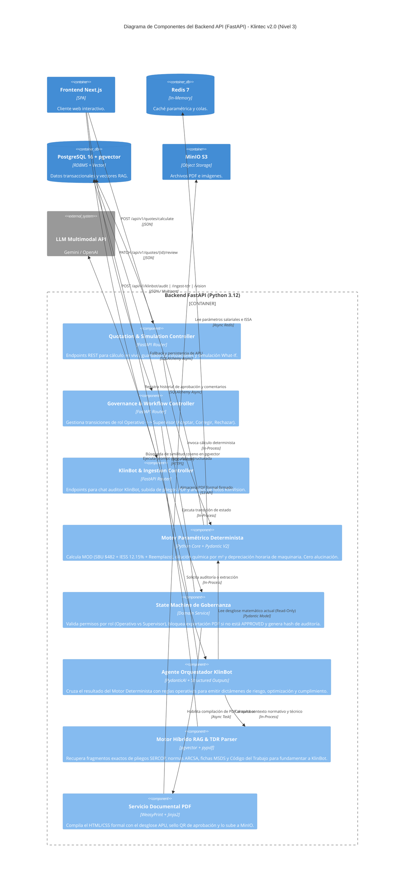

# INFORME MAESTRO Y PLAYBOOK INTEGRAL: KLINTEC v2.0 (HACKATHON EXPO CLEAN ECUADOR 2026)

**Proyecto:** Klintec — Sistema Dinámico de Cotización, Auditoría Operativa e Inteligencia de Costos Unitarios (APU) según Tipología de Infraestructura  
**Área Estratégica:** Gestión Inteligente de Procesos  
**Reto Oficial:** Reto 2 – Sistema dinámico de cotización y estructuración de costos unitarios según tipología de infraestructura  
**Equipo y Roles Oficiales:**
- **Nick Valverde:** Product Owner, Estrategia Comercial B2B, Validación en Sitio & Pitch Lead
- **Bryan Salazar:** Desarrollador Backend, Motor Paramétrico Determinista, Agente IA (KlinBot RAG/Vision) & Motor PDF
- **Alejandro Minda:** Desarrollador Frontend UI/UX Principal (Wizard Operativo, Flujo de Roles y Simulador)
- **Roberth Jácome:** Desarrollador Fullstack de Integración, Visualización Analítica (Recharts) & Infraestructura/Deploy

---

## I. Ficha Técnica del Evento, Contexto Sectorial y Premios

1. **Organización y Respaldo Institucional:** Tercera Edición de la Feria Internacional [Expo Clean Ecuador 2026](https://www.google.com/search?q=http%3A%2F%2Fexpocleanecuador.com.ec%2Fes%2Fprogramacion%2F), respaldada gremialmente por **FEDELIMP** (Federación Nacional de Empresas de Limpieza y Afines del Ecuador), **JIMCORPSERVI**, **UAO**, **Escuela Politécnica Nacional (EPN)**, **Conquito** y **LACIF** (Latin America Investment Facility – Unión Europea).
2. **Sede y Fechas Presenciales:** Centro de Exposiciones Quito (Pabellón posterior asignado). Viernes 16 y Sábado 17 de octubre de 2026 (con jornada previa realizada el 8 de octubre de 2026).
3. **Fondo de Premios Directos (USD $40.000 en total):** Se premian **12 proyectos en total (3 por cada una de las 4 Áreas Estratégicas)**. En el área de *Gestión Inteligente de Procesos*:
   - **1.er Lugar:** USD $5.000 en efectivo.
   - **2.º Lugar:** USD $3.000 en efectivo.
   - **3.er Lugar:** USD $2.000 en efectivo.
4. **Programa y Fondo de Aceleración Posterior (Enero – Marzo 2027):**
   - Proceso de 12 semanas para madurar el prototipo hacia un SaaS B2B comercializable con mentoría empresarial.
   - Bolsa adicional de hasta **USD $20.000** (hasta USD $10.000 para el primer lugar) destinada a infraestructura cloud, desarrollo, pilotos empresariales y validación en campo.
5. **Propiedad Intelectual (Anexo 1, Art. 14):** Permanece **100% en manos de los integrantes de Klintec**. No existe cesión automática de derechos patrimoniales sobre el código fuente, algoritmos, marcas ni diseños.
6. **Gobernanza y Reglas Críticas de Supervivencia:**
   - **Código Previo Autorizado:** Se permite llegar con arquitectura, base de código, semillas de base de datos y componentes UI preconfigurados.
   - **Datos Propios:** La organización no entrega datasets; el equipo provee su propio catálogo paramétrico basado en normativa ecuatoriana 2026.
   - **Asistencia Estricta:** Máximo 20% de ausencia justificada por jornada. **Todo el equipo (los 4 integrantes) debe subir físicamente al escenario durante el Pitch Final**; la ausencia de un miembro en tarima implica descalificación automática.

---

## II. Investigación Profunda del Problema (Reto 2) y Fundamentos Normativos 2026

### 1. Diagnóstico Ampliado del Problema en Ecuador y LATAM
El sector de limpieza profesional e higiene institucional (*Facility Management*) en Ecuador mueve millones de dólares anuales entre contratación privada (banca, centros comerciales, clínicas, industrias de alimentos) y contratación pública a través del [Portal de Compras Públicas del SERCOP](https://www.google.com/search?q=https%3A%2F%2Fportal.compraspublicas.gob.ec%2Fsercop%2Fservicios-de-limpieza%2F). Sin embargo, la industria sufre una **crisis estructural de tarifación** provocada por cuatro fallas críticas:

- **Falla 1: El mito del "costo plano por metro cuadrado":** La mayoría de las PYMEs cotizan dividiendo el metraje total para un valor empírico fijo (ej. $1,50 a $2,50/m²), ignorando las tasas de producción horaria estandarizadas internacionalmente por [ISSA Cleaning Times (8th Edition Metric LATAM)](https://www.google.com/search?q=https%3A%2F%2Fwww.issa.com%2Fcleaning-times-ed%2Fnew-8th-edition-issa-cleaning-times-metric-edition-latam%2F). Limpiar 1.000 m² de oficinas corporativas (rendimiento ~350 m²/hora) exige una fracción del tiempo, EPP y carga química que 1.000 m² de áreas críticas hospitalarias/UCI (rendimiento ~90–120 m²/hora con protocolos de desinfección terminal de alto nivel y validación por bioluminiscencia ATP < 50 RLU).
- **Falla 2: Desangre financiero por omisión de cargas laborales legales (Actualización Normativa 2026):** La Mano de Obra Directa (MOD) representa entre el **60% y el 70%** de la estructura de costos. En Ecuador, a partir del [Acuerdo Ministerial Nro. MDT-2025-195 del Ministerio del Trabajo](https://www.google.com/search?q=https%3A%2F%2Fwww.trabajo.gob.ec%2Fdespues-de-casi-una-decada-hay-consenso-gobierno-empleadores-y-trabajadores-acuerdan-fijar-el-salario-basico-unificado-de-2026-en-usd-482-no-hay-imposicion-hay-union%2F), el **Salario Básico Unificado (SBU) vigente en 2026 es de USD $482,00** (más los pisos salariales de las comisiones sectoriales para operarios especializados). Cuando un cotizador en Excel olvida incluir el [Aporte Patronal total del 12,15% al IESS](https://www.google.com/search?q=https%3A%2F%2Fsueldoec.com%2Fcalculadora-aporte-iess%2F) (11,15% seguro general + 0,5% IECE + 0,5% SECAP), el [Fondo de Reserva del 8,33%](https://www.google.com/search?q=https%3A%2F%2Fwww.iess.gob.ec%2Fdocuments%2F13718%2F54965%2FTasasdeaportacion.pdf), décimos mensualizados, vacaciones, recargo nocturno del 25% (jornada entre 19h00 y 06h00 según Art. 49 del Código del Trabajo) o el **Factor de Reemplazo / Ausentismo (1,15 a 1,25x)** para cubrir descansos de fin de semana, feriados, permisos médicos y maternidad, el contrato nace con pérdida operativa neta.
- **Falla 3: Sobredosificación o subdosificación química y depreciación invisible de maquinaria:** Sin una matriz matemática de dilución (ej. amonio cuaternario de 5.ª generación a 1:64 vs. desengrasante alcalino industrial a 1:20), las empresas compran insumos a ciegas, destruyendo su flujo de caja o incumpliendo normas sanitarias ARCSA. Asimismo, regalan el desgaste de maquinaria pesada (fregadoras hombre a bordo, abrillantadoras de alta revolución, nebulizadores ULV) al no prorratear su depreciación por hora efectiva de uso.
- **Falla 4: El divorcio Comercial vs. Operativo y la Competencia Desleal (Dumping):** El vendedor recorta precios en la mesa de negociación para ganar el contrato sin consultar al Supervisor de Operaciones. Cuando Operaciones recibe el contrato firmado, descubre que el presupuesto no alcanza ni para los químicos ni para los turnos prometidos, degradando la calidad del servicio.

### 2. ¿A quién está destinado Klintec y qué impacto genera?
- **Empresas de Limpieza y Facility Management (Socios de FEDELIMP y PYMEs):** Reducción del tiempo de estructuración de ofertas técnico-económicas de **3–5 días a menos de 3 minutos**, eliminando el 100% de los errores de cálculo aritmético y protegiendo el margen neto (EBITDA).
- **Entidades Contratantes Privadas y Públicas (SERCOP / Hospitales / Industrias):** Transparencia total mediante **Análisis de Precios Unitarios (APU)** auditables que justifican técnicamente cada centavo invertido en bioseguridad, evitando adjudicar contratos a ofertas temerarias que luego incumplen pagos al IESS.
- **Impacto Ambiental y Laboral (Alineado a LACIF e IESS):** Garantiza el respeto irrestricto al trabajo digno (SBU $482 + cargas legales completas) y reduce entre un **18% y 25% el desperdicio de agua y plásticos/químicos** mediante dosificación exacta por metro cuadrado.

---

## III. Resolución Técnica Ampliada de Klintec (Arquitectura Funcional en 4 Pilares)

### Pilar 1: Entrada de Requerimientos Multimodal y Parametrización Guiada
El módulo de ingesta soporta tres vías de entrada para adaptarse tanto a licitaciones formales como a visitas técnicas rápidas en campo:
1. **Formulario Wizard Estructurado (4 Tipologías Oficiales):**
   - *Hospitalaria / Crítica (Alto Riesgo):* Quirófanos, UCI, laboratorios. Exige desinfectantes de grado médico con registro ARCSA, EPP completo N95/tyvek, paños de microfibra codificados por colores (4 colores OMS para evitar contaminación cruzada) y rendimientos de 90–140 m²/h.
   - *Educativa (Medio-Alto Riesgo):* Escuelas, universidades, guarderías. Enfoque en químicos biodegradables hipoalergénicos no tóxicos, alta frecuencia en baterías sanitarias y superficies de alto contacto.
   - *Corporativa y Comercial (Bajo-Medio Riesgo):* Edificios empresariales, bancos, centros comerciales y patios de comida. Uso intensivo de maquinaria (fregadoras automáticas, aspiradoras HEPA) con rendimientos de 300–600 m²/h.
   - *Industrial y Logística (Especializada):* Plantas de alimentos (inocuidad BPM/HACCP), bodegas de gran altura, remoción de grasas pesadas e hidrocarburos con hidrolavadoras industriales y trabajo en alturas.
2. **Ingesta Inteligente de Pliegos PDF/TDR (KlinBot Document Parser):** Permite arrastrar un documento de Términos de Referencia (TDR) o pliego del SERCOP en PDF; el motor extrae automáticamente metrajes, frecuencias, turnos y exigencias técnicas para pre-llenar el cotizador.
3. **Asistente Visual de Levantamiento en Campo (KlinVision):** El operativo o supervisor sube una fotografía del espacio a intervenir (ej. piso de quirófano o nave industrial) desde su móvil/tablet y el modelo multimodal identifica el tipo de superficie, estado de desgaste, nivel de suciedad y sugiere la combinación óptima de químico y maquinaria.

### Pilar 2: Motor Paramétrico Determinista (Core Matemático Auditable)
Ningún cálculo financiero se delega a probabilidades de un modelo de lenguaje. Todo pasa por ecuaciones deterministas escritas en Python y validadas con Pydantic V2:

1. **Cálculo de Mano de Obra Directa Mensual ($MOD$):**
   $$\text{Horas Requeridas/Día} = \sum_{i=1}^{n} \left( \frac{\text{Área}_i \text{ (m}^2\text{)}}{\text{Rendimiento ISSA}_i \text{ (m}^2\text{/h)}} \times \text{Frecuencia Diaria}_i \right)$$
   $$\text{Operarios Base ($N_{op}$)} = \left\lceil \frac{\text{Horas Requeridas/Día}}{\text{Horas Efectivas por Turno (7,5 h)}} \right\rceil$$
   $$\text{Costo Mensual por Operario} = \left( \text{SBU}_{2026} + \text{Bonif. Especialidad} + \text{Recargo Nocturno}_{25\%} \right) + \text{IESS Patronal}_{12,15\%} + \text{Fondo Reserva}_{8,33\%} + \text{Décimo 3ro}_{8,33\%} + \text{Décimo 4to}_{\$40,17} + \text{Vacaciones}_{4,17\%}$$
   $$MOD_{\text{Total}} = N_{op} \times \text{Costo Mensual por Operario} \times \text{Factor de Reemplazo/Ausentismo } (1,18)$$

2. **Cálculo de Insumos Químicos, Dilución y Bioseguridad ($CIQ$):**
   $$\text{Litros Solución Lista} = \frac{\text{Área}_i \times \text{Frecuencia Mensual}}{\text{Rendimiento Superficie (m}^2\text{/L solución)}}$$
   $$\text{Litros Concentrado Puro} = \text{Litros Solución Lista} \times \left( \frac{1}{1 + \text{Factor Dilución } D} \right) \times (1 + \text{Merma}_{3\%})$$
   $$CIQ_{\text{Total}} = \sum (\text{Litros Concentrado Puro} \times \text{Costo Unitario Galón/Litro}) + \text{Costo Consumibles/Fundas/Microfibras} + \text{Kits EPP}$$

3. **Cálculo de Depreciación Horaria de Maquinaria y Equipos ($CMAQ$):**
   $$\text{Costo Horario Equipo}_k = \frac{\text{Valor Adquisición}_k - \text{Valor Residual}_k}{\text{Vida Útil en Horas}_k} + \text{Mantenimiento Preventivo/Hora}_k + \text{Consumibles Desgaste (Pads/Cepillos)}_k$$
   $$CMAQ_{\text{Total}} = \sum_{k} \left( \text{Costo Horario Equipo}_k \times \text{Horas de Uso Mensual}_k \right)$$

4. **Estructuración del Precio Final y Piso Legal Inviolable:**
   $$\text{Costo Operativo Directo (Piso Inviolable)} = MOD_{\text{Total}} + CIQ_{\text{Total}} + CMAQ_{\text{Total}}$$
   $$\text{Subtotal Oferta} = \text{Costo Operativo Directo} \times \left( 1 + \% \text{Gastos Administrativos} + \% \text{Imprevistos Riesgo} + \% \text{Margen Neto} \right)$$

### Pilar 3: Flujo de Gobernanza Operativo-Comercial (Sin caer en un CRM pesado) y Agente KlinBot
Para resolver el **Riesgo 3 (Desfase comercial vs. operativo)** sin perder tiempo construyendo un CRM complejo, Klintec implementa una **Máquina de Estados de Gobernanza Ligera (4 Estados)** apoyada por **KlinBot**:
- **Rol 1: Cotizador / Operativo Comercial:** Crea la cotización, ingresa metrajes/tipología (o sube pliego/foto) y obtiene el desglose del Motor Paramétrico. Antes de poder exportar el PDF formal, tiene dos acciones:
  1. **Consultar a KlinBot (Pre-Auditoría IA):** KlinBot revisa los parámetros contra la base de conocimiento RAG (normativa IESS 2026, fichas técnicas MSDS, estándares ARCSA/SERCOP) y emite alertas preventivas (ej. *"Atención: Estás cotizando 1.200 m² de quirófanos sin incluir nebulizador ULV ni amonio cuaternario de 5.ª generación; riesgo de descalificación técnica"*).
  2. **Enviar a Revisión de Supervisión:** Cambia el estado de `DRAFT` a `IN_REVIEW`.
- **Rol 2: Supervisor de Operaciones / Aprobador:** Visualiza una bandeja ejecutiva de validación (con KPIs de contratos activos, margen promedio y alertas de riesgo) y al abrir una cotización dispone de **4 acciones de gobernanza**:
  1. **Auditar con KlinBot:** Solicita un dictamen técnico-financiero rápido de optimización de turnos/maquinaria.
  2. **Aceptar y Sellar (`APPROVED`):** Genera el hash criptográfico de validación interna y habilita inmediatamente el botón de generación de Propuesta PDF y despacho por correo/WhatsApp.
  3. **Mandar a Corregir (`CHANGES_REQUESTED`):** Devuelve la cotización al operativo con comentarios puntuales anclados al rubro observado.
  4. **Rechazar (`REJECTED`):** Bloquea ofertas que violen políticas de rentabilidad o seguridad ocupacional.

### Pilar 4: Dashboards Interactivos, Simulador de Sensibilidad y Motor PDF
- **Matriz Analítica de Precios Unitarios (APU):** Tabla filtrable por Nómina, Químicos, Maquinaria y EPP con referencia legal de cada ítem.
- **Simulador de Sensibilidad Comercial y Mesa de Negociación ("What-If"):**
  - *Candado de Piso Legal FEDELIMP:* El slider de margen jamás permite reducir el precio por debajo del Costo Operativo Directo + Cargas Legales IESS.
  - *Termómetro Competitivo Sectorial:* Compara el costo por m² resultante contra el promedio histórico de licitaciones SERCOP en Pichincha.
  - *Simulador de Descuento en Vivo:* Botón para simular en tiempo real qué ocurre con la utilidad neta en dólares si el cliente pide un `-3%` o `-5%` de descuento en la negociación, manteniendo 100% blindada la nómina de los operarios.
- **Generación de Propuesta Técnico-Económica en PDF en 1 Clic:** Documento formal multipágina renderizado con WeasyPrint/HTML con membrete corporativo, resumen ejecutivo, tabla APU desglosada, certificaciones de bioseguridad y códigos QR de trazabilidad.

---

## IV. Stack Tecnológico Optimizado (Versiones Estables, Probadas y Fechas)

| Capa / Componente | Tecnología Propuesta | Versión Estable / LTS Recomendada | Fecha de Lanzamiento Ref. | Justificación Técnica y Beneficio Directo en el Hackathon |
| :--- | :--- | :--- | :--- | :--- |
| **Frontend Framework** | **Next.js (App Router + TypeScript)** | **v14.2.x LTS** (o v15.1 Estable con React 18.3.1) | Abril 2024 / Dic 2024 | Estabilidad total con todas las librerías de UI y gráficos sin conflictos de hidratación; compilación rápida y soporte SSR/CSR híbrido. |
| **UI & Sistema de Diseño** | **Tailwind CSS + shadcn/ui (Radix UI)** | **Tailwind v3.4.17** + **Radix Primitives v1.1** | Diciembre 2024 | Más probado y predecible en hackathons que Tailwind v4; permite construir el Wizard, Sliders, Modales de KlinBot y Badges de estado en minutos. |
| **Visualización de Datos** | **Recharts** | **v2.12.7** | Mayo 2024 | Totalmente compatible con React 18; renderiza gráficos de dona, barras apiladas y el termómetro competitivo con animaciones fluidas (<16 ms). |
| **Estado Cliente y Caché** | **Zustand + TanStack Query** | **Zustand v4.5.5** + **TanStack Query v5.59** | Ago 2024 / Oct 2024 | Zustand mantiene en memoria los cambios del slider y formulario sin re-renders costosos; TanStack Query sincroniza estados de aprobación y colas PDF. |
| **Validación de Esquemas FE** | **React Hook Form + Zod** | **RHF v7.53** + **Zod v3.23.8** | Septiembre 2024 | Bloquea entradas inválidas (metrajes negativos, porcentajes fuera de rango) en el navegador antes de tocar el backend. |
| **Backend API & Runtime** | **FastAPI sobre Python** | **Python 3.12.7** + **FastAPI v0.115.x** | Octubre 2024 | Python 3.12 ofrece mejoras de velocidad de ejecución del 15-20%; FastAPI 0.115 genera documentación Swagger/OpenAPI automática para demostrar la API al jurado técnico. |
| **Motor Determinista y Tipado** | **Pydantic V2 (Core en Rust)** | **v2.10.x** | Noviembre 2024 | Núcleo escrito en Rust que valida matrices salariales, fórmulas IESS 2026 y salidas estructuradas de IA en microsegundos. |
| **Agente IA (KlinBot & KlinVision)** | **PydanticAI / OpenAI o Gemini SDK + Structured Outputs** | **PydanticAI v0.0.14+ / Gemini 2.5 Flash / GPT-4o** | 2025 / 2026 | Garantiza respuestas tipadas (JSON estricto) para auditoría de cotizaciones, extracción de pliegos PDF y análisis visual de superficies por foto. |
| **Base de Datos & RAG Vectorial** | **PostgreSQL + extensión `pgvector`** | **PostgreSQL 16.6** + **pgvector v0.7.4** | Noviembre 2024 | **Mejora clave:** Al usar `pgvector` dentro del mismo PostgreSQL 16, tienen el motor relacional ACID y el motor RAG para KlinBot en un solo contenedor, sin levantar bases vectoriales externas pesadas. |
| **ORM y Migraciones** | **SQLAlchemy Async + Alembic** | **SQLAlchemy v2.0.36** + **Alembic v1.14** | Octubre 2024 | Consultas asíncronas no bloqueantes con `asyncpg` y tipado moderno `Mapped[]`. |
| **Caché y Cola de Mensajes** | **Redis Alpine** | **Redis v7.2.6 LTS / v7.4.1** | Octubre 2024 | Caché L1 (<2 ms) para tablas salariales IESS/SBU $482 y rendimientos ISSA, además de broker ligero para generación de documentos. |
| **Tareas Asíncronas** | **FastAPI `BackgroundTasks` (MVP) / ARQ** | **ARQ v0.26.1** (sobre Redis) | Julio 2024 | **Mejora clave:** ARQ es nativo `asyncio` y mucho más ligero de configurar que Celery para un hackathon de 48h, o bien usar `BackgroundTasks` nativo con Redis de respaldo. |
| **Motor de Documentos PDF** | **WeasyPrint + Jinja2** | **WeasyPrint v62.3 / v63.0** + **Jinja2 v3.1.4** | Noviembre 2024 | Transforma plantillas HTML5/CSS3 con diseño editorial corporativo en PDFs listos para firma electrónica sin depender de navegadores headless pesados. |
| **Almacenamiento de Archivos** | **MinIO (S3 Compatible)** | **RELEASE.2024-10-13** | Octubre 2024 | Almacena localmente en Docker los PDFs generados, fotos de levantamiento y fichas técnicas MSDS con URLs prefirmadas. |
| **Contenedores y Despliegue** | **Docker & Docker Compose V2** | **Docker Engine v27.3** + **Compose v2.29** | Septiembre 2024 | Permite levantar todo el ecosistema en local en la laptop de presentación sin depender del Wi-Fi del Centro de Exposiciones Quito, además de túnel Cloudflare/Vercel para acceso público. |

---

## V. Arquitectura C4 Completa en 3 Niveles (N1, N2 y N3 Actualizados con Roles y KlinBot)

### Nivel 1: Diagrama de Contexto del Sistema (C4 System Context)

### Nivel 2: Diagrama de Contenedores (C4 Container Diagram)

### Nivel 3: Diagrama de Componentes del Backend & Motor Inteligente (C4 Component Diagram)

---

## VI. Evaluación Estratégica de Ideas del Equipo + Nuevas Ideas Ganadoras

### 1. Evaluación de las 3 Ideas Propuestas por el Equipo

| Idea del Equipo | Veredicto | Análisis de Viabilidad, Costos y Riesgos | Cómo Implementarla sin Morir en el Intento (Alcance Hackathon) |
| :--- | :--- | :--- | :--- |
| **1. Arquitectura de 2 Roles (Operativo y Supervisor) con flujo de 4 acciones (KlinBot, Aceptar, Corregir, Rechazar)** | **EXCELENTE Y NECESARIA (10/10)** | **Ataca de raíz el Riesgo 3 (Desfase Comercial vs. Operativo).** Tu temor de construir un CRM por debajo es 100% válido: si intentan programar gestión de clientes, embudos de ventas, facturación o seguimiento post-venta, perderán el hackathon por dispersión. | **Solución: "Gobernanza de Cotización (Approval Gate)", NO un CRM.** Usen un selector rápido de rol en la barra superior (*Switch en vivo: Vista Cotizador Operativo / Vista Supervisor de Operaciones*) para que el jurado vea ambos lados en 10 segundos sin cerrar sesión. El PDF final permanece bloqueado con marca de agua `"BORRADOR NO VÁLIDO"` hasta que el Supervisor hace clic en **Aceptar**. |
| **2. KlinBot: Agente LLM + Motor RAG + Consulta al Motor de Parámetros** | **MUY POTENTE SI SE SEPARA DEL CÁLCULO (9.5/10)** | **Aclaración Crítica:** **NO entrenen (fine-tuning) un modelo de IA para hacer las multiplicaciones de costos.** Los LLMs fallan en aritmética fina y un jurado técnico de la EPN los cuestionará si un LLM calcula el IESS. La arquitectura ganadora es **Neuro-Simbólica**: el **Motor Determinista en Python** calcula los dólares con precisión de centavos (100% exacto), y **KlinBot (LLM + RAG)** recibe ese JSON calculado y actúa como **Auditor Técnico-Legal y Copiloto de Optimización**. Costo de API: **<$0,003 USD por auditoría** usando Gemini 2.5 Flash o GPT-4o-mini. | **Rol de KlinBot:** 1. **Auditor de Riesgo:** Detecta incoherencias (ej. turno nocturno sin recargo, hospital sin amonio de 5.ª gen). 2. **Optimizador Operativo:** Sugiere cambiar 2 operarios manuales en un centro comercial por 1 fregadora hombre a bordo, mostrando el ahorro mensual. 3. **Citas Normativas RAG:** Cita artículos reales del Código del Trabajo, ARCSA o SERCOP almacenados en PostgreSQL (`pgvector`). |
| **3. Visión por Computadora (Tomar fotografías para agilizar el levantamiento)** | **DIFERENCIADOR WOW (9/10) SI SE USA VLM VÍA API** | Entrenar una red neuronal propia (YOLO/ResNet) en 48 horas no es viable ni necesario. En cambio, usar la capacidad multimodal de un **VLM (Vision-Language Model como Gemini 2.5 Flash o GPT-4o Vision)** mediante un endpoint con salida JSON estructurada toma **menos de 2 horas de código** para Bryan y cuesta **$0,002 por imagen**. | **Módulo "KlinVision (Inspección Rápida en Sitio)":** En el Paso 1 del Wizard, agreguen un botón *"Autocompletar con Foto de Instalación"*. Suben en la demo una foto de un quirófano o una bodega industrial y el sistema devuelve automáticamente: `Superficie detectada: Vinilo hospitalario conductivo | Nivel de riesgo: Crítico | Insumo sugerido: Amonio Cuaternario 5ta Gen | Maquinaria: Fregadora compacta HEPA`. |

### 2. Cuatro Ideas Adicionales Ganadoras (Para Asegurar el 1.er Lugar)
1. **Candado Anti-Dumping Laboral ("Escudo Legal FEDELIMP"):** Tres de los siete jurados son empresarios del gremio FEDELIMP/JIMCORPSERVI, cuyo mayor dolor es competir contra empresas informales que tiran los precios por debajo del costo legal del IESS. Si el slider de margen en Klintec tiene una **"Zona Roja Bloqueada de Dumping Laboral"** que impide generar propuestas por debajo del Costo Directo Legal ($482 SBU + 12,15% IESS), los 3 jurados gremiales les darán calificación perfecta.
2. **Ingesta en 1 Clic de Pliegos del SERCOP ("SERCOP TDR Parser"):** Cuando una empresa licita con el Estado, recibe un PDF de 20 páginas del SERCOP. Agreguen un botón *"Importar Pliego SERCOP (PDF)"* que extraiga automáticamente la entidad contratante, metraje, turnos y exigencias microbiológicas, llenando todo el formulario en 5 segundos.
3. **Eco-Indicador de Dosificación Sostenible ("Huella Hídrica y Química LACIF"):** Uno de los jurados es delegado de **LACIF (Unión Europea)**, enfocado en sostenibilidad e impacto. Agreguen una tarjeta en el Dashboard que muestre: *"Ahorro ambiental proyectado por dosificación exacta Klintec: -420 litros de agua/mes y -18 envases plásticos de galón por uso de concentrados dosificados"*.
4. **Sello QR de Verificación Criptográfica en el PDF:** El PDF generado incluye un código QR real que, al ser escaneado por los jurados con su celular durante el pitch, abre una vista pública de verificación con el resumen del APU aprobado por el Supervisor y la certificación de cumplimiento laboral IESS 2026.

---

## VII. Estrategia para Maximizar los Criterios de Evaluación y Desempate (Anexo 5 y 6)

El Puntaje Final es el promedio simple de los 7 jurados ($\sum \text{Puntajes} \div 7$, sin eliminar el más alto ni el más bajo). En caso de empate, el **Anexo 5 (Sección 6.2)** establece el orden estricto de desempate:

| Orden de Desempate | Criterio de Evaluación | Peso Oficial | Qué Evalúa el Jurado en el Reto 2 | Cómo Klintec Obtiene el Puntaje Máximo |
| :---: | :--- | :---: | :--- | :--- |
| **1.º Desempate** | **Prototipo, demo o simulación práctica** | **20%** | Que el software exista, funcione en vivo sin caerse, calcule en tiempo real y genere un resultado verificable (no solo diapositivas o mockups estáticos). | Demo en vivo end-to-end: subir pliego/foto -> cálculo en <50 ms -> auditoría KlinBot -> cambio en vivo a rol Supervisor -> Aprobar -> descargar PDF real y escanear QR. |
| **2.º Desempate** | **Impacto potencial** | **15%** | Beneficio cuantificable en productividad, reducción de pérdidas financieras, formalización laboral y sostenibilidad en la industria. | Mostrar métricas claras: reducción de tiempo de cotización de **72 horas a 3 minutos (-99%)**, eliminación del 100% de multas/pérdidas por omisión de IESS/reemplazo y ahorro del 20% en químicos. |
| **3.º Desempate** | **Viabilidad técnica** | **15%** | Coherencia arquitectónica, precisión de las fórmulas matemáticas, factibilidad de implementación inmediata y manejo de riesgos. | Explicar la separación entre el **Motor Determinista (Python/Pydantic)** que nunca alucina números y **KlinBot (RAG en pgvector)** que audita normas, todo empaquetado en Docker. |
| **4.º Desempate** | **Innovación de la solución** | **15%** | Grado de novedad y diferenciación frente a hojas de Excel o ERPs genéricos. | Combinar **Precios Unitarios (APU) dinámicos por tipología** + **Gobernanza Operativo/Supervisor** + **KlinBot Auditor RAG + KlinVision**. |
| **5.º Desempate** | **Comprensión del problema** | **15%** | Dominio real del dolor sectorial (diferencia microbiológica entre hospital y oficina, SBU 2026 de $482, factor de reemplazo, SERCOP). | Hablar el lenguaje exacto del sector: citar el Acuerdo Ministerial MDT-2025-195 ($482), el 12,15% patronal, el factor de ausentismo 1,18x y las unidades RLU de bioluminiscencia. |
| **6.º Desempate** | **Calidad de la presentación / Pitch** | **10%** | Claridad, estructura ejecutiva, storytelling, manejo del tiempo y contundencia en preguntas. | Pitch cronometrado de 4 minutos donde la demo en vivo ocupa el corazón de la presentación y cada miembro conoce qué pregunta responder según el jurado. |
| **7.º Desempate** | **Proceso y trabajo en equipo** | **10%** | Organización interdisciplinaria, uso de las mentorías, iteración real en las 48h y participación de los 4 integrantes. | Mostrar en las rondas de mentoría nuestro tablero de Sprints, registrar en el **Anexo 12** el feedback de los mentores y subir los 4 al escenario con roles claros. |

---

## VIII. Alcance del MVP y Planificación Ágil por Micro-Sprints (Timeboxing 48h)

### 1. Qué Entra y Qué NO Entra en el MVP (Regla 80/20)
- **SÍ ENTRA (Core Ganador):**
  1. Selector instantáneo de Rol en el Header (`Operativo Comercial` vs. `Supervisor de Operaciones`) para fluidez en la demo.
  2. Wizard de Cotización con las 4 Tipologías precargadas con semillas reales (Hospital Metropolitano, Centro Comercial, Planta de Alimentos, Edificio Corporativo) + Botón de autocompletado por **Pliego PDF / Foto KlinVision**.
  3. Motor Paramétrico Determinista en FastAPI con cálculo exacto de MOD (SBU $482 + IESS 12,15% + Fondos Reserva 8,33% + Décimos + Recargo Nocturno 25% + Factor Reemplazo 1,18), Químicos (dilución) y Maquinaria.
  4. Panel de Desglose APU + Gráficos Recharts + Simulador de Margen con Candado Anti-Dumping y escenario What-If (-3% descuento).
  5. Copiloto **KlinBot** (Auditoría inteligente con RAG sobre normas ecuatorianas) + Flujo de 4 botones del Supervisor (*KlinBot, Aceptar, Mandar a Corregir, Rechazar*).
  6. Generación real de la Propuesta Técnico-Económica en PDF con código QR funcional.
- **NO ENTRA (Cortafuegos contra el Scope Creep):**
  - Login complejo con recuperación de contraseñas, OAuth o gestión de usuarios multi-empresa (usar cambio de rol en 1 clic).
  - Módulo CRM de seguimiento de clientes, facturación electrónica SRI o pasarela de pagos.
  - CRUD administrativo infinito para editar catálogos de químicos (cargar el catálogo vía script de semillas `seed.py` y mostrar solo una vista de lectura/ajuste rápido).

### 2. Metodología: "Hack-Scrum" de 4 Micro-Sprints
En lugar de Sprints tradicionales de 2 semanas, aplicaremos **4 Micro-Sprints de 4 a 6 horas** sincronizados con los bloques del Manual del Hackathon, con *Daily Checkpoints* de 5 minutos cada 3 horas.

| Épica | Historia de Usuario (HU) | Responsable | Tareas Concretas (Tasks) y Criterio de Aceptación |
| :--- | :--- | :--- | :--- |
| **ÉPICA 1: Motor Determinista & Semillas Normativas 2026 (Sprint 1: Viernes Mañana)** | **HU-01:** Como sistema, necesito calcular con exactitud determinista la MOD, insumos químicos y depreciación de maquinaria según la tipología y turnos. | **Bryan Salazar** (Backend / IA) | - Configurar esquema PostgreSQL 16 + `seed.py` con SBU $482, IESS 12.15%, 4 tipologías, 12 químicos ARCSA y 8 maquinarias. - Programar `calc_engine.py` con Pydantic V2 y endpoint `POST /api/v1/quotes/calculate` (<50 ms con caché Redis). |
| **ÉPICA 2: Interfaz Wizard, Desglose APU & Simulador (Sprint 1-2: Viernes)** | **HU-02:** Como Operativo Comercial, quiero ingresar metrajes por superficie y simular márgenes con un slider para estructurar una cotización en vivo. | **Alejandro Minda** (Frontend UI/UX) | - Maquetar el layout corporativo (basado en los mockups de Stich) con navegación de 4 pasos y *Role Switcher* en el topbar. - Construir el Configurador de Instalaciones (Paso 1), la Matriz APU filtrable (Paso 2) y el Simulador de Sensibilidad con Candado Anti-Dumping (Paso 3). |
| **ÉPICA 3: Analítica Visual, Estado Global & Despliegue (Sprint 2: Viernes Tarde)** | **HU-03:** Como usuario, necesito visualizar gráficos dinámicos de composición del costo y el termómetro competitivo SERCOP en tiempo real. | **Roberth Jácome** (Fullstack & Charts) | - Conectar Zustand + TanStack Query entre el formulario de Alejandro y los endpoints de Bryan. - Implementar en Recharts la barra proporcional de Costo Directo, el Termómetro Competitivo Pichincha y la tabla comparativa *What-If (-3%)*. - Levantar Docker Compose + dominio público / túnel estable. |
| **ÉPICA 4: Gobernanza Operativo-Supervisor, KlinBot RAG & PDF (Sprint 3: Viernes Noche - Sábado Mañana)** | **HU-04:** Como Supervisor de Operaciones, quiero auditar las cotizaciones con KlinBot y decidir entre Aceptar, Mandar a Corregir o Rechazar antes de habilitar el PDF. | **Bryan + Alejandro + Roberth** | - **Bryan:** Implementar endpoint `/api/v1/klinbot/audit` (con RAG sobre normas IESS/ARCSA/SERCOP), endpoint multimodal `/vision` y generador PDF con WeasyPrint. - **Alejandro:** Construir el panel lateral de KlinBot y la barra de 4 acciones del Supervisor (*KlinBot, Aceptar, Corregir, Rechazar*). - **Roberth:** Integrar visor de vista previa del PDF (Paso 4) y descarga real con QR. |
| **ÉPICA 5: Validación Comercial en Expo Clean, Entregables & Pitch (Sprint 4: Viernes a Sábado 14:00)** | **HU-05:** Como Product Owner, necesito validar los parámetros con empresarios reales en la feria, documentar los Anexos y liderar un pitch impecable. | **Nick Valverde** (Product Owner / Líder) | - Entrevistar a 5 gerentes en los stands de Expo Clean el viernes (evidencia real para el criterio de Validación). - Redactar los 7 entregables oficiales (Anexo 5 y Anexo 12 de mentorías). - Congelar código el sábado a las 14:00 y dirigir 5 ensayos cronometrados del Pitch con los 4 integrantes en escena. |

---

## IX. Estrategia de Mentorías y Cronograma Operativo Maestro

### 1. Cómo Exprimir las Mentorías y Qué Preguntar (Lo que ninguna IA puede darte)
Los mentores y expositores del evento no solo dan consejos: **validan la credibilidad sectorial del equipo** y dejan constancia en el **Anexo 12 (Registro de Mentoría)**. Hay datos empíricos de calle en Quito que solo ellos tienen y que, si los mencionas en el Pitch final (*"Como validamos ayer con los mentores de FEDELIMP..."*), blindan tu presentación:

- **Preguntas para Mentores Empresariales / FEDELIMP / Operaciones:**
  1. *"En licitaciones reales en Quito durante este último año, ¿cuál es el porcentaje real de ausentismo/rotación que les está golpeando más fuerte en turnos nocturnos y hospitalarios: 15%, 18% o más del 20%?"*
  2. *"Cuando un cliente corporativo o el SERCOP les pide rebajar el presupuesto en mesa de negociación, ¿cuál es el rubro donde las empresas suelen cometer el error fatal de recortar primero?"*
  3. *"En nuestro flujo Supervisor-Operativo, incluimos 4 botones (KlinBot, Aceptar, Mandar a Corregir, Rechazar). Como gerente de operaciones, ¿qué indicador único necesita ver en menos de 5 segundos para darle al botón 'Aceptar' con tranquilidad?"*
- **Preguntas para Catalina Saraus (Expositora Magistral en Formulación Química LATAM):**
  1. *"En Ecuador, ¿qué error de dilución química ve con más frecuencia en limpieza hospitalaria o industrial que destruye superficies o encarece el contrato sin mejorar la desinfección?"*
- **Preguntas para Hendrith Caripa (Expositor de Pitch) y Mentores Técnicos/LACIF:**
  1. *"En un pitch de 4 minutos donde el prototipo vale el 20% y define el desempate, ¿prefieren que mostremos el caso de uso sobre una licitación hospitalaria crítica desde el minuto 1 de la demo?"*

### 2. Cronograma Operativo Unificado (Viernes 16 y Sábado 17 de Octubre 2026)

| Día y Horario | Bloque Oficial (Manual / Agenda Sábado) | Acción Interna del Equipo Klintec (Por Rol) |
| :--- | :--- | :--- |
| **VIERNES 16 OCT** `08:00 – 09:00` | **Acreditación y Ubicación** | Instalación en mesa asignada, prueba de tomas eléctricas, router local/hotspot de respaldo y verificación de Docker Compose en las 4 laptops. |
| `09:00 – 10:00` | **Apertura y Presentación de Retos** | Nick toma nota de cualquier matiz adicional anunciado por el jurado o coordinación sobre el Reto 2. |
| `10:00 – 11:00` | **Comprensión (Problema y Usuario)** | **Inicio Sprint 1:** Bryan levanta BD y motor determinista; Alejandro inicia Wizard Paso 1; **Nick sale 40 min a los stands de la feria Expo Clean** a entrevistar a 3–5 gerentes de empresas de limpieza para levantar métricas reales de dolor. |
| `11:30 – 13:00` | **Ideación y Selección** | Integración de hallazgos de la feria en las semillas de datos; Roberth conecta estado global Zustand y estructura gráficos Recharts. |
| `14:00 – 16:00` | **Diseño de Solución y Propuesta** | **Sprint 2:** Conexión completa Frontend-Backend del flujo principal (Pasos 1, 2 y 3). El slider de margen ya mueve los números reales en vivo. |
| `16:00 – 16:30` | **Mentoría 1 (Primera Revisión)** | Mostrar el cálculo determinista ya funcionando al mentor. Hacer las 3 preguntas sectoriales y llenar el **Anexo 12**. |
| `16:30 – 18:30` | **Prototipado Intensivo** | **Sprint 3:** Bryan integra KlinBot (RAG + Structured Outputs) y generación PDF con WeasyPrint; Alejandro construye la vista del Supervisor (4 acciones: KlinBot, Aceptar, Corregir, Rechazar). |
| `18:30 – 19:00` | **Checkpoint Día 1** | Prueba del flujo completo de punta a punta y commit seguro en rama `main-stable`. |
| **SÁBADO 17 OCT** `08:30 – 09:00` | **Reingreso y Revisión de Estado** | Sincronización de 10 minutos (Daily Standup). Verificación del entorno de demo en el dominio público y en `localhost`. |
| `09:00 – 10:00` | **Desarrollo Final y Mentorías** | Pulido visual del PDF generado (QR funcional), integración de KlinVision (análisis de foto) y pruebas de estrés del slider *What-If*. |
| `10:00 – 10:30` | **Conferencia: "Pitch que convence" (Hendrith Caripa)** | **Nick asiste y toma nota** de los tips del expositor para ajustar el guion; Bryan, Alejandro y Roberth dejan listo el caso de demostración (*Hospital Metropolitano*). |
| `11:00 – 11:30` | **Conferencia: "El futuro no avisa: IA" (María de Gonzalo)** | Asistencia del equipo convocado; alinear el discurso de KlinBot con la visión de liderazgo e IA responsable. |
| `11:30 – 13:15` | **Validación Integral y Revisión Final (105 min con todos los mentores)** | **Hito Crítico:** Ejecutar el *Happy Path* frente a todos los mentores. Recoger sus objeciones sobre costos, riesgos y modelo de negocio B2B SaaS para blindar las respuestas al jurado. |
| `14:00 – 15:00` | **Ajustes Finales y CODE FREEZE** | **14:00 CODE FREEZE ESTRICTO.** Prohibido tocar lógica del backend. Grabar video MP4 de respaldo de la demo funcionando por si falla la red o el proyector. Empaquetar entregables finales (Anexo 5). |
| `15:00 – 16:00` | **Conferencia (Catalina Saraus) & Ensayo General** | Mientras los convocados asisten a la charla, ensayar la coreografía del Pitch entre los 4 integrantes con cronómetro en mano. |
| `16:00 – 16:15` | **Entrega Oficial de Hitos** | Nick entrega puntualmente a Mónica Sevilla y William Chamorro todos los materiales verificados. |
| `16:15 – 18:15` | **Presentaciones Finales ante el Jurado** | **Suben los 4 integrantes al escenario.** Ejecución del Pitch + Demo en vivo de Klintec. |
| `18:15 – 19:00` | **Deliberación y Premiación** | Anuncio de los 12 proyectos ganadores y cierre. |

---

## X. Estructura y Guion Ganador del Pitch (4 Minutos + Q&A)

**Regla Presencial Obligatoria:** Nick, Bryan, Alejandro y Roberth suben juntos al escenario. Mientras Nick lidera la narrativa, Alejandro u Roberth operan la demo en vivo en pantalla exactamente sincronizados con la voz de Nick. En la ronda de preguntas, Nick da el pase al especialista según el perfil del jurado que pregunte.

1. **Minuto 0:00 – 0:40 | El Gancho Financiero y Sectorial (Comprensión del Problema - 15%):**
   > *"Imaginen ganar hoy una licitación de limpieza hospitalaria por $360.000 dólares anuales... y descubrir en el segundo mes que su empresa pierde $2.800 dólares cada 30 días. ¿Por qué ocurre esto todos los días en Ecuador? Porque seguimos cotizando áreas críticas de salud con hojas de Excel rotas o un precio plano por metro cuadrado, olvidando el factor de reemplazo de 1,18, los recargos nocturnos sobre el SBU de $482 o la dilución real de amonios cuaternarios de quinta generación. Y peor aún: el vendedor recorta el precio para cerrar la venta sin que el Supervisor de Operaciones pueda detenerlo. Somos Klintec, y convertimos pliegos complejos en cotizaciones técnico-económicas blindadas y auditadas en menos de 3 minutos."*

2. **Minuto 0:40 – 2:30 | La Demo en Vivo sin Fricción (Prototipo y Simulación - 20% y Criterio de Desempate):**
   - **Paso 1 (Ingesta + KlinVision):** *"Veámoslo en vivo con un caso real: el Hospital Metropolitano de Quito, 4.850 m². En lugar de digitar a mano durante días, nuestro operativo carga el pliego o toma una foto del piso clínico con KlinVision. El sistema detecta vinilo conductivo de alto riesgo y aplica estándares ISSA LATAM y ARCSA."*
   - **Paso 2 (Motor Determinista):** *"En menos de 30 milisegundos, nuestro motor determinista en Python —no un modelo que adivina números, sino ingeniería de costos pura— estructura la Matriz de Precios Unitarios: 18 operarios en turnos 24/7 con el 12,15% de aporte patronal IESS, fondos de reserva y dosificación exacta de insumos."*
   - **Paso 3 (Flujo Operativo -> Supervisor + KlinBot):** *"Aquí resolvemos el divorcio comercial-operativo. Antes de enviar al cliente, el Supervisor entra a su bandeja y activa a KlinBot, nuestro agente con RAG conectado a la normativa laboral y sanitaria ecuatoriana. KlinBot audita la oferta, confirma que no hay subcotización y el Supervisor presiona 'Aceptar y Sellar'."*
   - **Paso 4 (Simulador Anti-Dumping + PDF con QR):** *"¿Y si el cliente pide un 3% de descuento en la mesa de negociación? Lo simulamos en un clic viendo cómo impacta nuestro margen neto, pero con el Candado FEDELIMP que bloquea cualquier oferta por debajo del piso legal laboral. En un clic, generamos la Propuesta Formal en PDF lista para el SERCOP o el cliente privado, con código QR que ustedes pueden escanear ahora mismo."*

3. **Minuto 2:30 – 3:15 | Viabilidad Técnica e Impacto Cuantificable (Viabilidad 15% + Impacto 15%):**
   - *"Reducimos el tiempo de cotización de 4 días a 3 minutos, protegemos el 100% del cumplimiento patronal con el IESS, evitamos la competencia desleal para las empresas de FEDELIMP y reducimos hasta un 22% el desperdicio de químicos y agua gracias a la dosificación paramétrica."*

4. **Minuto 3:15 – 4:00 | Modelo de Negocio B2B SaaS y Próximo Paso hacia la Aceleración:**
   - *"Klintec opera bajo un modelo SaaS B2B por suscripción escalonada ($49/mes para PYMEs y $149/mes para empresas licitadoras multi-contrato con KlinBot ilimitado). Con el capital semilla y las 12 semanas del programa de aceleración en enero, desplegaremos pilotos reales con 10 empresas de FEDELIMP para estandarizar el costeo de limpieza profesional en el Ecuador. Muchas gracias."*
